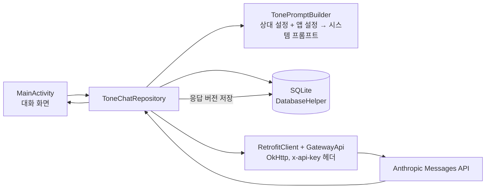

# AI 오늘의 말투 변환기

상대와 상황에 맞게 한국어 문장을 바꿔 주는 Android 앱입니다. 상대별 말투 설정(관계, 말투 키워드, 자기소개)과 대화 이력을 SQLite에 저장해 두고, 변환할 때마다 Claude API에 함께 보내므로 매번 상황을 다시 설명하지 않아도 됩니다.

- 순천향대학교 스마트폰 애플리케이션 프로그래밍 기말 프로젝트 · 2026
- 개발 기간: 약 3개월 · 팀원 3명
- 사용 기술: Java, Android SDK 35, SQLite, Retrofit, OkHttp, JavaMail, Claude Messages API

## 목차

- [해결하려는 문제](#해결하려는-문제)
- [담당 업무](#담당-업무)
- [주요 기능](#주요-기능)
- [구조](#구조)
- [실행 방법](#실행-방법)
- [현재 상태와 한계](#현재-상태와-한계)

## 해결하려는 문제

범용 AI 채팅으로 말투를 바꾸려면 받는 사람과 상황을 매번 설명해야 하고, 결과를 메신저로 따로 옮겨야 합니다. 이 앱은 상대마다 프롬프트 설정을 한 번 저장해 두고, 입력·변환·미리보기·재생성·복사·공유를 한 화면에서 처리합니다.

## 담당 업무

| 팀원 | 담당 |
|---|---|
| 이은정 | 기획, AI 기능 고도화, 계정·DB·API 연동 구조 설계, Android 개발(DB, 인증, 대화 로직, API 연동) |
| 박가영 | UI/UX 디자인 |
| 조한빈 | API 연동, 프롬프트 작성, 기능 개선 |

저장소는 기말 제출 시점에 한 번에 올렸기 때문에(2026-07-01, 07-02) 커밋 기록으로 팀원별 작업을 구분할 수는 없습니다. 위 표는 팀 내 역할 분담 기준입니다.

이은정이 담당한 범위와 관련된 코드:

| 기능 | 파일 |
|---|---|
| DB 스키마와 대화·버전 저장 | `DatabaseHelper.java` (users, prompts, keywords, chat_messages, message_versions) |
| 회원가입·이메일 인증·비밀번호 | `SignupActivity.java`, `EmailVerifier.java`(6자리 코드, 5분 유효), `PasswordUtil.java`(SHA-256 + 사용자별 솔트), `PasswordChangeActivity.java` |
| 대화 화면 로직 | `MainActivity.java` (입력 멈춘 뒤 1.2초 미리보기, 버전 탐색, 길게 눌러 수정, 임시 저장) |
| API 연동 | `data/api/RetrofitClient.java`, `data/api/GatewayApi.java`, `data/ToneChatRepository.java`(HTTP 401/400/429/529 오류를 한국어 안내로 변환) |

## 주요 기능

- **상대별 프롬프트**: 2단계 생성(상대 이름·그룹·자기소개 → 기본 20개 중 최대 5개 말투 키워드, 직접 추가 가능), 즐겨찾기와 그룹별 사이드바
- **말투 변환**: 시스템 프롬프트(상대, 키워드, 자기소개, 기억 메모, 금지 표현)와 대화 이력을 함께 전송. 온도 0.3, 응답 길이 설정에 따라 max_tokens 4096 / 8192 / 16000
- **버전 관리**: 응답을 왼쪽으로 밀어 재생성, 화살표로 버전 이동, 길게 눌러 직접 수정(API 호출 없이 새 버전으로 저장), 버전별 좋아요/싫어요 저장
- **실시간 미리보기(선택)**: 입력을 멈추고 1.2초 뒤 변환하고, 미리보기가 보이는 상태에서 전송하면 그 결과를 재사용해 추가 호출을 하지 않음
- **계정**: SMTP 이메일 인증, 비밀번호 재설정, 계정별 데이터 분리
- **설정**: 변환 강도, 응답 길이, 금지 표현, 테마(시스템/라이트/다크), 글자 크기 4단계

화면별 상세 설명은 [AI_Tone_Converter/USER_GUIDE.md](AI_Tone_Converter/USER_GUIDE.md), 영문 상세 명세는 [AI_Tone_Converter/README.md](AI_Tone_Converter/README.md)에 있습니다.

## 구조



| 경로 | 내용 |
|---|---|
| `AI_Tone_Converter/app/src/main/java/com/example/aitonechanger/` | 화면(Activity), DB, 인증, 설정 |
| `.../data/` | 프롬프트 생성, 변환 요청 처리, Retrofit 인터페이스와 요청·응답 모델 |
| `AI_Tone_Converter/local.properties.example` | API 키와 SMTP 설정 예시(값 없음) |
| `AI_말투변환기_학술보고서.docx`, `PPT 발표 자료.pdf` | 보고서와 발표 자료 |

## 실행 방법

필요 환경: Android Studio, Android SDK 35, Java 11, Anthropic API 키(유료 API), 선택적으로 Gmail 앱 비밀번호.

1. Android Studio에서 `AI_Tone_Converter` 폴더를 엽니다.
2. `AI_Tone_Converter/local.properties.example`을 `local.properties`로 복사하고 값을 채웁니다. 이 파일은 `.gitignore`에 포함되어 있으며 커밋하면 안 됩니다.

   ```properties
   ANTHROPIC_API_KEY=
   GATEWAY_BASE_URL=https://api.anthropic.com/
   GATEWAY_MODEL=claude-sonnet-4-6
   SMTP_HOST=smtp.gmail.com
   SMTP_PORT=587
   SMTP_EMAIL=
   SMTP_PASSWORD=
   ```

   SMTP 값을 비워 두면 인증 코드를 메일 대신 화면에 표시하는 데모 모드로 동작합니다.
3. 기기나 에뮬레이터에서 Run 'app'을 실행합니다.

이번 문서 정리에서는 빌드와 실행을 다시 확인하지 않았습니다(작업 환경에 Android SDK 없음).

## 현재 상태와 한계

- Android 클라이언트가 API를 직접 호출합니다. `local.properties`를 Git에서 제외해도 빌드된 앱의 `BuildConfig` 값은 추출될 수 있으므로, 배포하려면 서버 프록시와 서버 측 인증이 필요합니다.
- 응답 피드백은 저장만 하며 모델 재학습이나 개인화 학습으로 이어지지 않습니다.
- 미리보기 재사용에 따른 비용·응답 시간 개선율은 측정하지 않았습니다.
- 저장소에 자동화 테스트 코드가 없습니다.

## 라이선스

라이선스가 지정되지 않았습니다.
